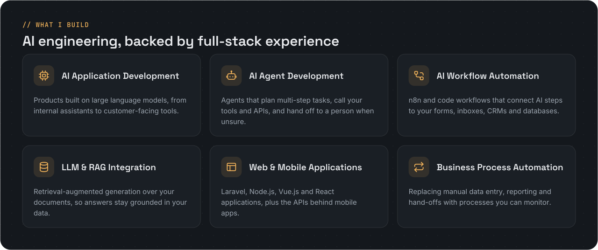
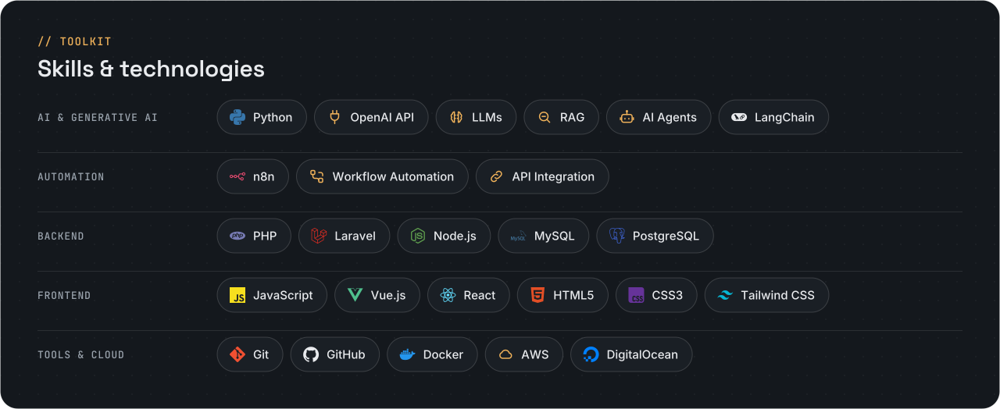
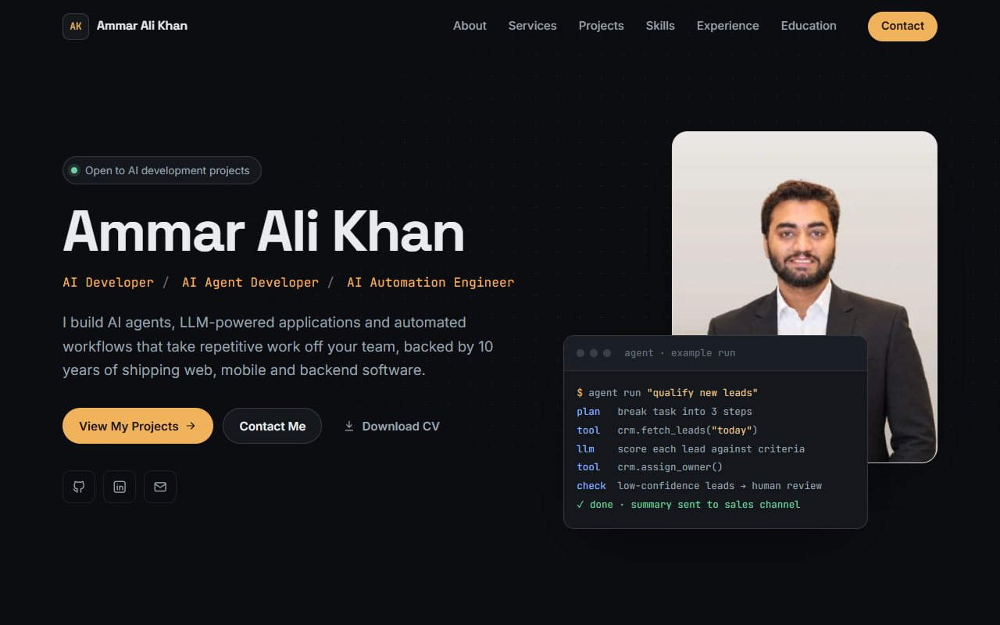
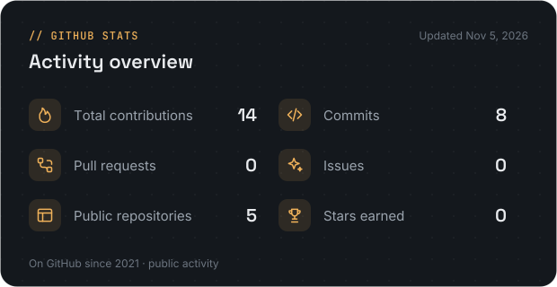
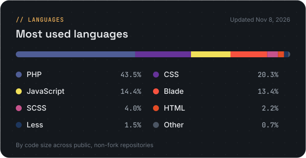
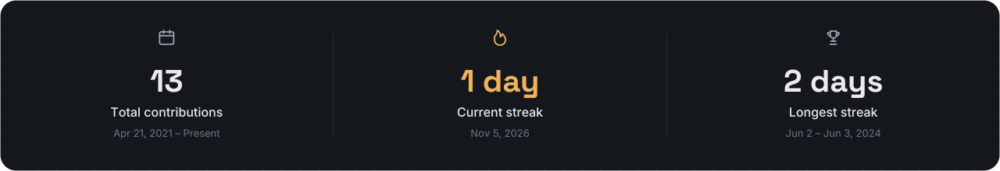
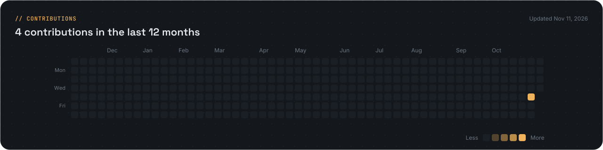

  

  
  
  
  
  
  

## About

I'm a software developer with **10 years of experience** across web applications, backend engineering, mobile app backends and API integrations.

Today my focus is **AI engineering**: intelligent applications, AI agents and automated workflows that take repetitive work off a team and help a business run with less manual effort. A decade of backend work shapes how I build them, with clean data, reliable integrations and code that is easy to maintain.

- **Currently building:** AI agents and n8n automations that connect large language models to everyday business tools.
- **Currently exploring:** agent tool-calling patterns, retrieval-augmented generation (RAG) and LangChain.
- **Open to:** AI development projects and AI engineering roles, working remotely with international teams.

  

## Toolkit

  

<b>Toolkit as text</b>

| Area | Technologies |
| :--- | :--- |
| **AI & Generative AI** | Python · OpenAI API · LLMs · RAG · AI Agents · LangChain |
| **Automation** | n8n · Workflow Automation · API Integration |
| **Backend** | PHP · Laravel · Node.js · MySQL · PostgreSQL |
| **Frontend** | JavaScript · Vue.js · React · HTML5 · CSS3 · Tailwind CSS |
| **Tools & Cloud** | Git · GitHub · Docker · AWS · DigitalOcean |

## Featured projects

<table>
<tr>
<td width="55%" valign="top">

</td>
<td width="45%" valign="top">

### AI Developer Portfolio

My personal portfolio: services, filterable projects, skills, experience and contact, built as a fast static site with no framework or backend.

**Tech:** HTML5 · CSS3 · JavaScript · GitHub Pages

[**Live site →**](https://ammar197khan.github.io/ammar-portfolio/) 
[**Repository →**](https://github.com/ammar197khan/ammar-portfolio)

</td>
</tr>
</table>

#### Client projects I've contributed to

| Project | My contribution |
| :--- | :--- |
| [**Qareeb**](https://qareeb.io/) | Built scalable, Docker-based services for an AI-driven IoT platform. |
| [**Compass Poultry**](https://compasspoultry.app/) | Developed a poultry management system with mobile access to real-time flock reports. |
| **HelloFix** | Platform connecting homeowners with service professionals; integrated Firebase Auth and third-party APIs. |
| [**Auto Glass Now**](https://www.autoglassnow.com/) | Built a service booking platform with location-based search and warranty information. |
| [**Universal Service Fund**](https://www.usf.org.pk/) | Contributed to the Laravel and REST API backend for a government broadband programme. |

Client work for employers and clients. The source code is private, and the products belong to their owners.

## GitHub stats

  
  

  

  

Generated daily from the GitHub API by a workflow in this repository. Public activity only.

## Connect with me

  
  

Have a process that AI could take off your plate? Reach out on LinkedIn or through my portfolio.

